# Encrypted semantic file sharing

Local semantic search over encrypted shared documents, built on the complete [SecuShare application](https://github.com/SecuShare/SecuShare). The existing React/TypeScript frontend and Go/SQLite backend remain intact. A Python research client uses the app's real upload, share, download and revocation APIs, with a local sentence encoder and two ciphertext storage sidecars.

The added workflow combines client-side AES-GCM, a pinned MiniLM encoder, bounded Path ORAM indexes, private session deltas and immutable epoch merges. A recipient imports an explicit share link into a separate search corpus. File keys stay in the link fragment and trusted client state. Revocation prevents future server downloads; it cannot erase copies or keys a recipient already obtained.

## Architecture and execution guide

<!-- execution-flow:start -->
### Execution flow

Start with the primary path, then expand a detailed workflow. Select a numbered node to see its operation, implementation techniques, and source. Solid arrows show the named control, data, or lifecycle handoff; dotted arrows show error paths. Separate entry points are named in each workflow.

<a id="review-walkthrough"></a>

#### Walk through one concrete example

Run the owner-side sharing and indexing workflow for a text document, placing its encoded record in the owner session corpus.

**Trace.** [Encrypt and share document](#flow-step-encrypt-upload-share) → [Authorize share download](#flow-step-share-download-gates) → [Encode sentence locally](#flow-step-encode-text) → [Pack bounded index record](#flow-step-index-record) → [Add record to private session delta](#flow-step-session-delta).

**Result and boundary.** The client encrypts and shares the document, verifies its ciphertext round trip, encodes the recovered text locally, and adds a bounded record to a private session delta. Search and epoch merge are separate calls. The file server does not automatically embed uploads, and the recipient still needs the fragment key.

<details>
<summary>Implementation decisions to explain</summary>

**Why encrypt the document before sending it through the API?** Encryption keeps plaintext on the client side of the sharing boundary while the service handles ciphertext. The recipient needs the separately conveyed fragment key to decrypt.

[Client-side AES-GCM and fragment key handoff](#technique-client-encryption).

**Why put the new record in a session delta?** The private delta captures new records before an immutable merged epoch is published. This supports incremental updates but means a delta is distinct from a fully activated searchable snapshot.

[Session-private deltas and isolated visibility](#technique-session-epoch-merge).

</details>

#### Primary execution flow

Owner workflow called by _drive. API request is a called transport boundary.

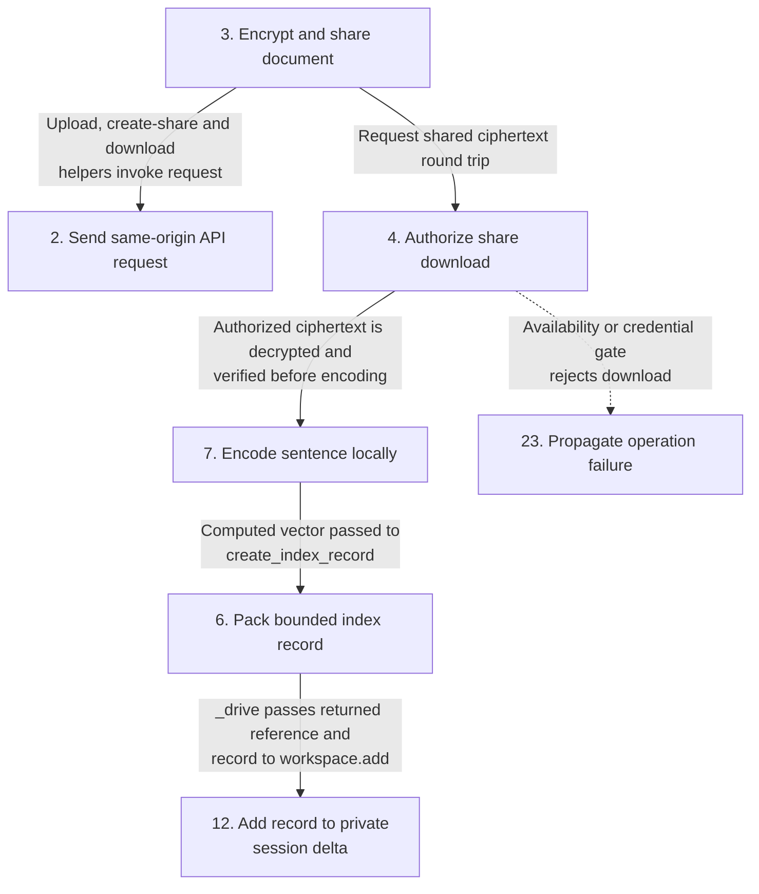

**Detailed workflows.** [Verified owner ingestion](#flow-workflow-owner-ingestion) · [Explicit recipient import](#flow-workflow-recipient-import) · [Create or append a session index](#flow-workflow-delta-storage) · [Read and remap one block](#flow-workflow-logical-read) · [Search an authenticated snapshot](#flow-workflow-search) · [Build and activate a new epoch](#flow-workflow-epoch-merge) · [Revoke future downloads](#flow-workflow-revocation) · [Synthetic verification calls](#flow-workflow-verification) · [Independent lifecycle commands](#flow-workflow-lifecycle).

<a id="flow-workflow-owner-ingestion"></a>

<details>
<summary>Verified owner ingestion</summary>

Owner workflow called by _drive. API request is a called transport boundary.


</details>

<a id="flow-workflow-recipient-import"></a>

<details>
<summary>Explicit recipient import</summary>

Recipient imports an explicit link into a separate corpus.

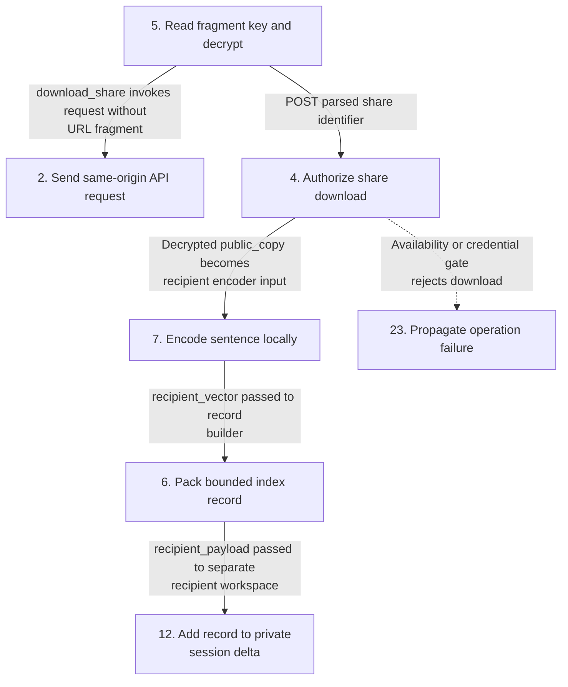

</details>

<a id="flow-workflow-delta-storage"></a>

<details>
<summary>Create or append a session index</summary>

Creation and append are distinct from a logical read.

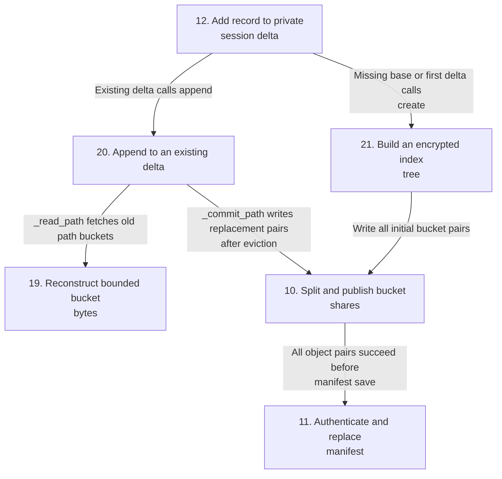

</details>

<a id="flow-workflow-logical-read"></a>

<details>
<summary>Read and remap one block</summary>

Independent logical read, exercised by verification; semantic search uses records snapshots.

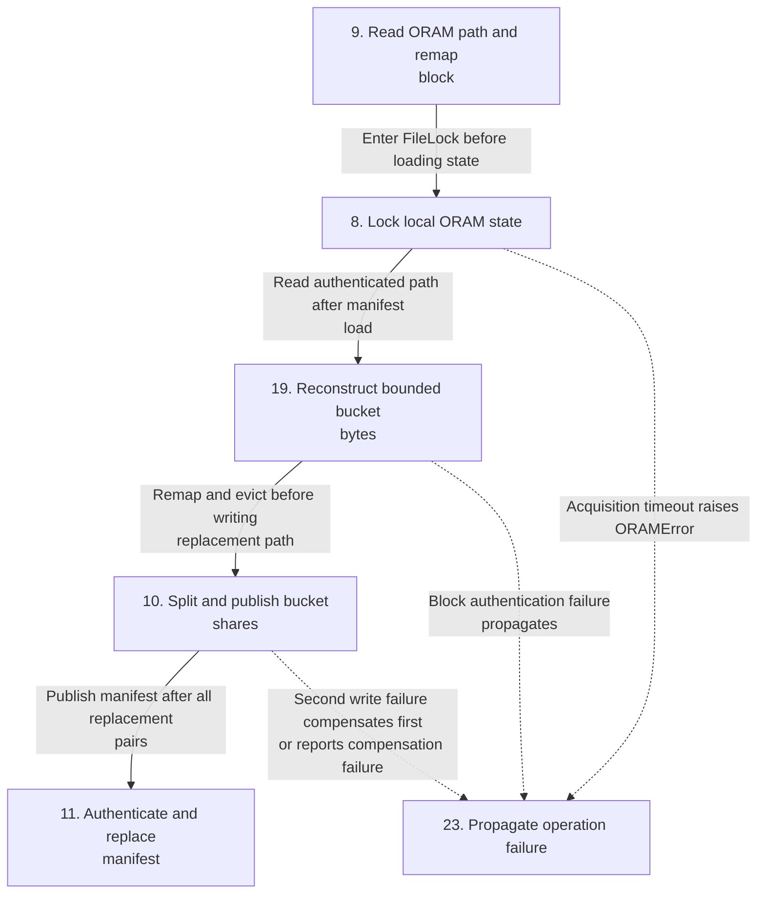

</details>

<a id="flow-workflow-search"></a>

<details>
<summary>Search an authenticated snapshot</summary>

No automatic search-to-merge handoff exists.

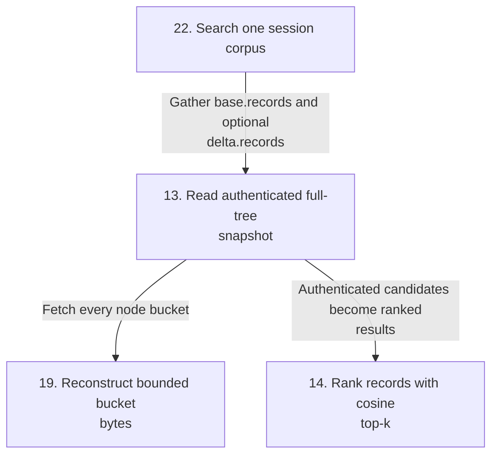

</details>

<a id="flow-workflow-epoch-merge"></a>

<details>
<summary>Build and activate a new epoch</summary>

Separate merge operation. Failed create attempts local staging cleanup; remote objects have no general rollback.

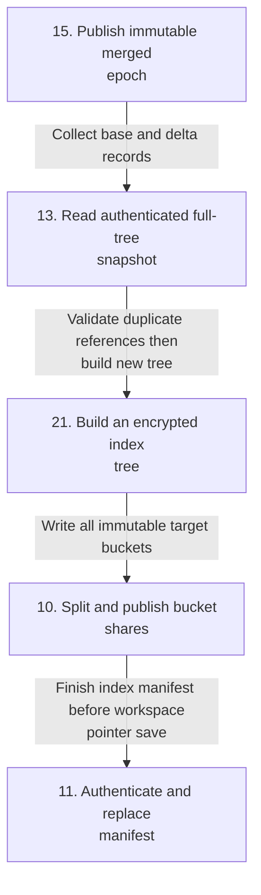

</details>

<a id="flow-workflow-revocation"></a>

<details>
<summary>Revoke future downloads</summary>

Independent owner API call. Already obtained copies and keys remain available.

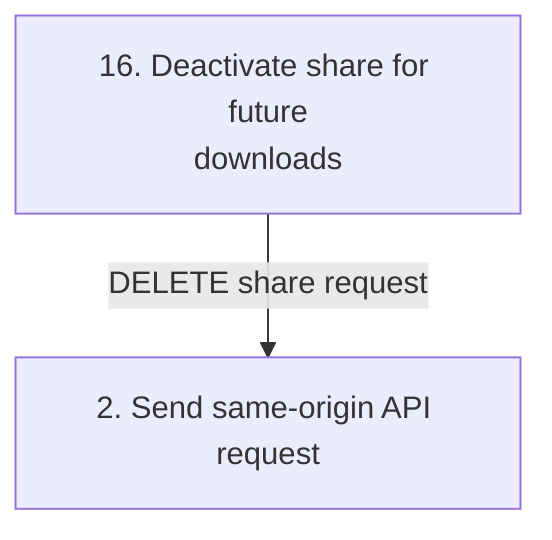

</details>

<a id="flow-workflow-verification"></a>

<details>
<summary>Synthetic verification calls</summary>

Edges show explicit verifier calls, not automatic operation handoffs.

```mermaid
flowchart TD
    n17["17. Write workflow evidence"]
    click n17 href "https://github.com/STEVVVU/encrypted-semantic-file-sharing#flow-step-drive-evidence" "Open step, techniques, and source" _top
    n3["3. Encrypt and share document"]
    click n3 href "https://github.com/STEVVVU/encrypted-semantic-file-sharing#flow-step-encrypt-upload-share" "Open step, techniques, and source" _top
    n22["22. Search one session corpus"]
    click n22 href "https://github.com/STEVVVU/encrypted-semantic-file-sharing#flow-step-workspace-search" "Open step, techniques, and source" _top
    n15["15. Publish immutable merged<br/>epoch"]
    click n15 href "https://github.com/STEVVVU/encrypted-semantic-file-sharing#flow-step-epoch-merge" "Open step, techniques, and source" _top
    n5["5. Read fragment key and decrypt"]
    click n5 href "https://github.com/STEVVVU/encrypted-semantic-file-sharing#flow-step-parse-fragment-decrypt" "Open step, techniques, and source" _top
    n16["16. Deactivate share for future<br/>downloads"]
    click n16 href "https://github.com/STEVVVU/encrypted-semantic-file-sharing#flow-step-revoke-share" "Open step, techniques, and source" _top
    n9["9. Read ORAM path and remap<br/>block"]
    click n9 href "https://github.com/STEVVVU/encrypted-semantic-file-sharing#flow-step-oram-read-remap" "Open step, techniques, and source" _top
    n17 -->|"Upload synthetic documents"| n3
    n17 -->|"Check delta and merged-base ranking"| n22
    n17 -->|"Explicitly call merge"| n15
    n17 -->|"Import explicit recipient share link"| n5
    n17 -->|"Deactivate owner share"| n16
    n17 -->|"Compare logical read message shapes"| n9
```

</details>

<a id="flow-workflow-lifecycle"></a>

<details>
<summary>Independent lifecycle commands</summary>

launch and cleanup are independent main command branches. drive requires launched state and calls doctor; ordinary drive does not call cleanup.

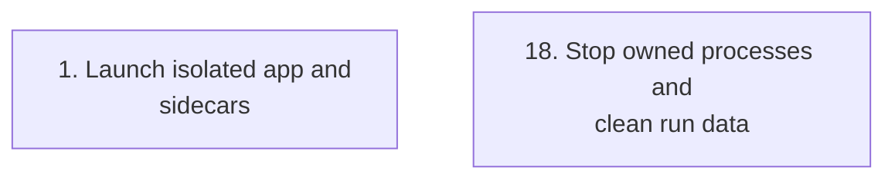

</details>

#### Steps, techniques, and source

These source traces cover the active scope below. They explain implementation behavior; benchmark results and their limits remain in the measurement sections.

<a id="flow-step-owned-launch"></a>

##### 1. Launch isolated app and sidecars

**Component.** lifecycle.start. The launcher starts the configured app and two sidecars for a validated run ID, records owned process identities and run configuration, and keeps run data in the isolated run directory. Doctor checks the exact processes and loopback endpoints before drive proceeds.

**Techniques at this step.** [Owned-process launch and identity-checked cleanup](#technique-owned-run-lifecycle).

**Source.** [`research/semantic-sharing/src/semshare/lifecycle.py:33`](https://github.com/STEVVVU/encrypted-semantic-file-sharing/blob/main/research/semantic-sharing/src/semshare/lifecycle.py#L33). [Back to execution flow](#execution-flow).

<a id="flow-step-api-request"></a>

##### 2. Send same-origin API request

**Component.** SecuShareClient.request. The client validates its fixed loopback API origin and applies session and CSRF headers. HTTP errors return bounded status/header/body data to the caller; transport errors raise AppError. Cross-origin redirects are refused.

**Techniques at this step.** [Loopback API and CSRF request boundary](#technique-api-origin-csrf-boundary).

**Source.** [`research/semantic-sharing/src/semshare/app_client.py:43`](https://github.com/STEVVVU/encrypted-semantic-file-sharing/blob/main/research/semantic-sharing/src/semshare/app_client.py#L43) · [`research/semantic-sharing/src/semshare/app_client.py:68`](https://github.com/STEVVVU/encrypted-semantic-file-sharing/blob/main/research/semantic-sharing/src/semshare/app_client.py#L68). [Back to execution flow](#execution-flow).

<a id="flow-step-encrypt-upload-share"></a>

##### 3. Encrypt and share document

**Component.** SecuShareClient.upload_encrypted and workflow.upload_share_and_embed. The client encrypts plaintext with AES-GCM, uploads ciphertext, creates a share, then downloads the share and verifies that decryption reproduces the input bytes. The share key remains client-side and is placed in the URL fragment for recipient handoff.

**Techniques at this step.** [Client-side AES-GCM and fragment key handoff](#technique-client-encryption) · [Authenticated share round-trip verification](#technique-verified-share-roundtrip).

**Source.** [`research/semantic-sharing/src/semshare/app_client.py:104`](https://github.com/STEVVVU/encrypted-semantic-file-sharing/blob/main/research/semantic-sharing/src/semshare/app_client.py#L104) · [`research/semantic-sharing/src/semshare/workflow.py:27`](https://github.com/STEVVVU/encrypted-semantic-file-sharing/blob/main/research/semantic-sharing/src/semshare/workflow.py#L27) · [`research/semantic-sharing/src/semshare/workflow.py:76`](https://github.com/STEVVVU/encrypted-semantic-file-sharing/blob/main/research/semantic-sharing/src/semshare/workflow.py#L76). [Back to execution flow](#execution-flow).

<a id="flow-step-share-download-gates"></a>

##### 4. Authorize share download

**Component.** ShareHandler.DownloadFile and ShareService.GetFile. The public-share handler parses optional password, requester email and verification code, then GetFile checks active status, expiry, download limit, password and any required email verification. The repository atomically rechecks availability while incrementing download count before file lookup. Errors map to HTTP failures; this handler does not obtain an authenticated owner identity.

**Techniques at this step.** [Server-enforced share expiry, download limits, and revocation](#technique-share-availability-gates).

**Source.** [`backend/internal/handler/share_handler.go:324`](https://github.com/STEVVVU/encrypted-semantic-file-sharing/blob/main/backend/internal/handler/share_handler.go#L324) · [`backend/internal/service/share_service.go:256`](https://github.com/STEVVVU/encrypted-semantic-file-sharing/blob/main/backend/internal/service/share_service.go#L256) · [`backend/internal/service/share_service.go:311`](https://github.com/STEVVVU/encrypted-semantic-file-sharing/blob/main/backend/internal/service/share_service.go#L311) · [`backend/internal/repository/share_repository.go:105`](https://github.com/STEVVVU/encrypted-semantic-file-sharing/blob/main/backend/internal/repository/share_repository.go#L105). [Back to execution flow](#execution-flow).

<a id="flow-step-parse-fragment-decrypt"></a>

##### 5. Read fragment key and decrypt

**Component.** SecuShareClient.parse_share_link and download_share. The recipient parses the share ID from the path and the AES key from the URL fragment, which is not sent in the HTTP request. The client downloads ciphertext and decrypts it locally; a wrong key or authentication tag failure rejects the plaintext.

**Techniques at this step.** [Client-side AES-GCM and fragment key handoff](#technique-client-encryption) · [Authenticated share round-trip verification](#technique-verified-share-roundtrip).

**Source.** [`research/semantic-sharing/src/semshare/app_client.py:168`](https://github.com/STEVVVU/encrypted-semantic-file-sharing/blob/main/research/semantic-sharing/src/semshare/app_client.py#L168) · [`research/semantic-sharing/src/semshare/app_client.py:139`](https://github.com/STEVVVU/encrypted-semantic-file-sharing/blob/main/research/semantic-sharing/src/semshare/app_client.py#L139). [Back to execution flow](#execution-flow).

<a id="flow-step-index-record"></a>

##### 6. Pack bounded index record

**Component.** workflow.create_index_record. The workflow packs file and share identifiers, filename, nonce, key material, vector, and integrity data into the fixed-size record format. The size limit rejects records that do not fit the configured slot.

**Techniques at this step.** [Fixed-size index record packing](#technique-bounded-index-record).

**Source.** [`research/semantic-sharing/src/semshare/workflow.py:56`](https://github.com/STEVVVU/encrypted-semantic-file-sharing/blob/main/research/semantic-sharing/src/semshare/workflow.py#L56). [Back to execution flow](#execution-flow).

<a id="flow-step-encode-text"></a>

##### 7. Encode sentence locally

**Component.** SentenceEncoder.encode. The pinned local model produces token embeddings; the encoder masks padding, computes a mean over valid tokens, and normalizes each output vector. The workflow uses the local vector for index insertion and query ranking.

**Techniques at this step.** [Masked mean pooling and vector normalization](#technique-model-mean-pooling).

**Source.** [`research/semantic-sharing/src/semshare/encoder.py:32`](https://github.com/STEVVVU/encrypted-semantic-file-sharing/blob/main/research/semantic-sharing/src/semshare/encoder.py#L32). [Back to execution flow](#execution-flow).

<a id="flow-step-oram-lock"></a>

##### 8. Lock local ORAM state

**Component.** FileLock.__enter__. The client acquires its process and file lock with a bounded wait before loading or changing ORAM state. Lock acquisition timeout aborts the operation; the context manager releases the lock on exit.

**Techniques at this step.** [Bounded process and file locking](#technique-client-state-lock).

**Source.** [`research/semantic-sharing/src/semshare/oram.py:176`](https://github.com/STEVVVU/encrypted-semantic-file-sharing/blob/main/research/semantic-sharing/src/semshare/oram.py#L176) · [`research/semantic-sharing/src/semshare/oram.py:210`](https://github.com/STEVVVU/encrypted-semantic-file-sharing/blob/main/research/semantic-sharing/src/semshare/oram.py#L210). [Back to execution flow](#execution-flow).

<a id="flow-step-oram-read-remap"></a>

##### 9. Read ORAM path and remap block

**Component.** PathORAM.read. PathORAM.read locks and authenticates state, fetches an assigned or random path, remaps a known block, evicts eligible stash blocks and commits replacement buckets. Missing or malformed identifiers perform a random-path access and return None. Workspace.search uses full records snapshots, not remapping reads.

**Techniques at this step.** [Path ORAM remapping and bottom-up eviction](#technique-path-oram-access) · [Padded fixed-slot authenticated buckets](#technique-fixed-slot-aead).

**Source.** [`research/semantic-sharing/src/semshare/oram.py:329`](https://github.com/STEVVVU/encrypted-semantic-file-sharing/blob/main/research/semantic-sharing/src/semshare/oram.py#L329) · [`research/semantic-sharing/src/semshare/oram.py:421`](https://github.com/STEVVVU/encrypted-semantic-file-sharing/blob/main/research/semantic-sharing/src/semshare/oram.py#L421) · [`research/semantic-sharing/src/semshare/oram.py:453`](https://github.com/STEVVVU/encrypted-semantic-file-sharing/blob/main/research/semantic-sharing/src/semshare/oram.py#L453). [Back to execution flow](#execution-flow).

<a id="flow-step-sidecar-xor-write"></a>

##### 10. Split and publish bucket shares

**Component.** SidecarPair.put and ObjectStore.put. The trusted client creates a random share and XORs it with the bucket bytes to form the second share, then sends one bounded frame to each loopback sidecar. Each object store publishes with no-overwrite atomic creation; a partial pair failure triggers compensation where implemented.

**Techniques at this step.** [Random XOR share publication with compensation](#technique-xor-share-splitting) · [Pooled HTTP with strict sidecar frame bounds](#technique-bounded-sidecar-transport) · [Atomic no-overwrite sidecar object publication](#technique-atomic-sidecar-object-write).

**Source.** [`research/semantic-sharing/src/semshare/oram.py:140`](https://github.com/STEVVVU/encrypted-semantic-file-sharing/blob/main/research/semantic-sharing/src/semshare/oram.py#L140) · [`research/semantic-sharing/src/semshare/oram.py:78`](https://github.com/STEVVVU/encrypted-semantic-file-sharing/blob/main/research/semantic-sharing/src/semshare/oram.py#L78) · [`research/semantic-sharing/src/semshare/sidecar.py:27`](https://github.com/STEVVVU/encrypted-semantic-file-sharing/blob/main/research/semantic-sharing/src/semshare/sidecar.py#L27). [Back to execution flow](#execution-flow).

<a id="flow-step-manifest-state"></a>

##### 11. Authenticate and replace manifest

**Component.** PathORAM._save_state and _load_state. Open and operations authenticate the manifest before use. _commit_path writes all new bucket pairs before atomically replacing the encrypted local manifest, then deletes old objects. Delete failures increment gc_failures; multi-object writes have no general remote rollback.

**Techniques at this step.** [Authenticated manifest validation and atomic replacement](#technique-authenticated-manifest).

**Source.** [`research/semantic-sharing/src/semshare/oram.py:482`](https://github.com/STEVVVU/encrypted-semantic-file-sharing/blob/main/research/semantic-sharing/src/semshare/oram.py#L482) · [`research/semantic-sharing/src/semshare/oram.py:496`](https://github.com/STEVVVU/encrypted-semantic-file-sharing/blob/main/research/semantic-sharing/src/semshare/oram.py#L496). [Back to execution flow](#execution-flow).

<a id="flow-step-session-delta"></a>

##### 12. Add record to private session delta

**Component.** Workspace.add. Workspace.add locks and authenticates workspace state, creates an empty session-specific base if needed, then creates the first delta or appends to an existing delta. Search and merge are separate calls. Each session has its own active base pointer.

**Techniques at this step.** [Session-private deltas and isolated visibility](#technique-session-epoch-merge).

**Source.** [`research/semantic-sharing/src/semshare/workspace.py:62`](https://github.com/STEVVVU/encrypted-semantic-file-sharing/blob/main/research/semantic-sharing/src/semshare/workspace.py#L62) · [`research/semantic-sharing/src/semshare/workspace.py:84`](https://github.com/STEVVVU/encrypted-semantic-file-sharing/blob/main/research/semantic-sharing/src/semshare/workspace.py#L84). [Back to execution flow](#execution-flow).

<a id="flow-step-full-tree-snapshot"></a>

##### 13. Read authenticated full-tree snapshot

**Component.** PathORAM.records and _snapshot. The query path reads and authenticates the full ORAM tree snapshot, reconstructing all records for a consistent local scan. It does not claim that the sidecars cannot observe access metadata.

**Techniques at this step.** [Authenticated full-tree read-only snapshots](#technique-full-tree-snapshot).

**Source.** [`research/semantic-sharing/src/semshare/oram.py:354`](https://github.com/STEVVVU/encrypted-semantic-file-sharing/blob/main/research/semantic-sharing/src/semshare/oram.py#L354) · [`research/semantic-sharing/src/semshare/oram.py:363`](https://github.com/STEVVVU/encrypted-semantic-file-sharing/blob/main/research/semantic-sharing/src/semshare/oram.py#L363). [Back to execution flow](#execution-flow).

<a id="flow-step-exact-ranking"></a>

##### 14. Rank records with cosine top-k

**Component.** Workspace.search and encoder.cosine. The client computes cosine scores against the local query vector and sorts the complete candidate set to return the requested top results. A fresh plaintext-vector oracle in the verification drive checks ranking and scores for the synthetic corpus.

**Techniques at this step.** [Exact cosine top-k with a fresh oracle](#technique-embedding-ranking).

**Source.** [`research/semantic-sharing/src/semshare/workspace.py:84`](https://github.com/STEVVVU/encrypted-semantic-file-sharing/blob/main/research/semantic-sharing/src/semshare/workspace.py#L84) · [`research/semantic-sharing/src/semshare/encoder.py:56`](https://github.com/STEVVVU/encrypted-semantic-file-sharing/blob/main/research/semantic-sharing/src/semshare/encoder.py#L56). [Back to execution flow](#execution-flow).

<a id="flow-step-epoch-merge"></a>

##### 15. Publish immutable merged epoch

**Component.** Workspace.merge and _save. Merge writes the session's merged records as a new immutable epoch, then switches the active epoch pointer only after the new snapshot succeeds. On failure the old epoch remains active; the previous epoch is retained for the merge result.

**Techniques at this step.** [Session-private deltas and isolated visibility](#technique-session-epoch-merge) · [Immutable epoch publication with failure rollback](#technique-immutable-snapshots).

**Source.** [`research/semantic-sharing/src/semshare/workspace.py:113`](https://github.com/STEVVVU/encrypted-semantic-file-sharing/blob/main/research/semantic-sharing/src/semshare/workspace.py#L113) · [`research/semantic-sharing/src/semshare/workspace.py:166`](https://github.com/STEVVVU/encrypted-semantic-file-sharing/blob/main/research/semantic-sharing/src/semshare/workspace.py#L166). [Back to execution flow](#execution-flow).

<a id="flow-step-revoke-share"></a>

##### 16. Deactivate share for future downloads

**Component.** SecuShareClient.deactivate_share and ShareService.Deactivate. The owner requests share deactivation through the API. Subsequent status or download requests observe the inactive share and fail; revocation cannot erase ciphertext, plaintext, or keys a recipient already obtained.

**Techniques at this step.** [Server-enforced share expiry, download limits, and revocation](#technique-share-availability-gates).

**Source.** [`research/semantic-sharing/src/semshare/app_client.py:222`](https://github.com/STEVVVU/encrypted-semantic-file-sharing/blob/main/research/semantic-sharing/src/semshare/app_client.py#L222) · [`backend/internal/service/share_service.go:752`](https://github.com/STEVVVU/encrypted-semantic-file-sharing/blob/main/backend/internal/service/share_service.go#L752). [Back to execution flow](#execution-flow).

<a id="flow-step-drive-evidence"></a>

##### 17. Write workflow evidence

**Component.** cli.drive and _drive. drive calls doctor and runs synthetic upload, search, merge, recipient, revocation and ORAM assertions. The CLI atomically saves the successful report or attempts to save failure details. Launch and ordinary cleanup are separate commands.

**Techniques at this step.** [Authenticated share round-trip verification](#technique-verified-share-roundtrip) · [Exact cosine top-k with a fresh oracle](#technique-embedding-ranking).

**Source.** [`research/semantic-sharing/src/semshare/cli.py:40`](https://github.com/STEVVVU/encrypted-semantic-file-sharing/blob/main/research/semantic-sharing/src/semshare/cli.py#L40) · [`research/semantic-sharing/src/semshare/cli.py:281`](https://github.com/STEVVVU/encrypted-semantic-file-sharing/blob/main/research/semantic-sharing/src/semshare/cli.py#L281). [Back to execution flow](#execution-flow).

<a id="flow-step-owned-cleanup"></a>

##### 18. Stop owned processes and clean run data

**Component.** lifecycle.cleanup. Cleanup verifies each process against the recorded ownership identity before stopping it and removes only the matching isolated run data. It preserves evidence separately; an ownership mismatch prevents stopping an unrelated process.

**Techniques at this step.** [Owned-process launch and identity-checked cleanup](#technique-owned-run-lifecycle).

**Source.** [`research/semantic-sharing/src/semshare/lifecycle.py:187`](https://github.com/STEVVVU/encrypted-semantic-file-sharing/blob/main/research/semantic-sharing/src/semshare/lifecycle.py#L187) · [`research/semantic-sharing/src/semshare/lifecycle.py:303`](https://github.com/STEVVVU/encrypted-semantic-file-sharing/blob/main/research/semantic-sharing/src/semshare/lifecycle.py#L303). [Back to execution flow](#execution-flow).

<a id="flow-step-sidecar-read"></a>

##### 19. Reconstruct bounded bucket bytes

**Component.** SidecarPair.get. SidecarPair.get fetches each assigned object through bounded loopback HTTP and XORs the bytes. Path and full-tree readers authenticate the reconstructed AEAD slots before accepting records.

**Techniques at this step.** [Random XOR share publication with compensation](#technique-xor-share-splitting) · [Pooled HTTP with strict sidecar frame bounds](#technique-bounded-sidecar-transport).

**Source.** [`research/semantic-sharing/src/semshare/oram.py:152`](https://github.com/STEVVVU/encrypted-semantic-file-sharing/blob/main/research/semantic-sharing/src/semshare/oram.py#L152). [Back to execution flow](#execution-flow).

<a id="flow-step-oram-append"></a>

##### 20. Append to an existing delta

**Component.** PathORAM.append. append locks and loads state, checks capacity, revision and duplicate references, reads a random path, inserts a fresh randomly assigned block and evicts before _commit_path.

**Techniques at this step.** [Path ORAM remapping and bottom-up eviction](#technique-path-oram-access) · [Padded fixed-slot authenticated buckets](#technique-fixed-slot-aead).

**Source.** [`research/semantic-sharing/src/semshare/oram.py:308`](https://github.com/STEVVVU/encrypted-semantic-file-sharing/blob/main/research/semantic-sharing/src/semshare/oram.py#L308). [Back to execution flow](#execution-flow).

<a id="flow-step-oram-create"></a>

##### 21. Build an encrypted index tree

**Component.** PathORAM.create. create validates bounded records and capacity, generates keys and random block identities and leaves, fills all buckets with real or dummy AEAD slots, writes the bucket pairs and saves the manifest.

**Techniques at this step.** [Padded fixed-slot authenticated buckets](#technique-fixed-slot-aead) · [Immutable epoch publication with failure rollback](#technique-immutable-snapshots).

**Source.** [`research/semantic-sharing/src/semshare/oram.py:240`](https://github.com/STEVVVU/encrypted-semantic-file-sharing/blob/main/research/semantic-sharing/src/semshare/oram.py#L240). [Back to execution flow](#execution-flow).

<a id="flow-step-workspace-search"></a>

##### 22. Search one session corpus

**Component.** Workspace.search. Workspace.search validates the query, holds the workspace lock and opens only that session's base and delta. It gathers full-tree records before scoring and sorting.

**Techniques at this step.** [Session-private deltas and isolated visibility](#technique-session-epoch-merge).

**Source.** [`research/semantic-sharing/src/semshare/workspace.py:84`](https://github.com/STEVVVU/encrypted-semantic-file-sharing/blob/main/research/semantic-sharing/src/semshare/workspace.py#L84). [Back to execution flow](#execution-flow).

<a id="flow-step-operation-failure"></a>

##### 23. Propagate operation failure

**Component.** SidecarPair.put. Bounds, authentication, transport and lock timeout errors propagate. Second-side write failure attempts to delete the first share; compensation failure is reported. Ordinary drive failure does not automatically run cleanup.

Explicit operation boundary or terminal error, with no separate ledger technique.

**Source.** [`research/semantic-sharing/src/semshare/oram.py:140`](https://github.com/STEVVVU/encrypted-semantic-file-sharing/blob/main/research/semantic-sharing/src/semshare/oram.py#L140). [Back to execution flow](#execution-flow).

<details>
<summary>Scope and subsystem coverage</summary>

The research semantic-sharing client, directly used SecuShare share upload/download/revocation gates, local ORAM and sidecar storage, session and epoch operations, and owned-run launch and cleanup. The workflow assumes trusted clients and does not claim formal security or sidecar non-collusion.

- **SecuShare API boundary and client key handoff.** The client constrains request origin, keeps the key in the URL fragment, and verifies local decryption after API download. [Step 2](#flow-step-api-request), [Step 3](#flow-step-encrypt-upload-share), [Step 5](#flow-step-parse-fragment-decrypt).
- **Share authorization, limits, and revocation.** The Go handler and service gate downloads and atomically enforce limits; deactivation blocks future downloads. [Step 4](#flow-step-share-download-gates), [Step 16](#flow-step-revoke-share).
- **Verified ingestion and bounded index record layout.** Authenticated round-trip precedes fixed-size record packing. [Step 3](#flow-step-encrypt-upload-share), [Step 5](#flow-step-parse-fragment-decrypt), [Step 6](#flow-step-index-record).
- **Local sentence encoding and exact semantic ranking.** Masked local pooling produces vectors; the client scans a full authenticated snapshot and ranks exact cosine scores. [Step 7](#flow-step-encode-text), [Step 13](#flow-step-full-tree-snapshot), [Step 14](#flow-step-exact-ranking), [Step 22](#flow-step-workspace-search).
- **ORAM access, encrypted blocks, and local state coordination.** The client locks state, remaps Path ORAM blocks, authenticates fixed-slot encrypted buckets and the manifest. [Step 8](#flow-step-oram-lock), [Step 9](#flow-step-oram-read-remap), [Step 11](#flow-step-manifest-state), [Step 20](#flow-step-oram-append), [Step 21](#flow-step-oram-create), [Step 23](#flow-step-operation-failure).
- **Two-sidecar transport and object publication.** The trusted client sends bounded XOR shares to the two sidecars, whose stores publish objects atomically without overwrite. [Step 10](#flow-step-sidecar-xor-write), [Step 19](#flow-step-sidecar-read).
- **Private session deltas and immutable epoch activation.** Session writes stay private until a new immutable snapshot succeeds and becomes active. [Step 12](#flow-step-session-delta), [Step 15](#flow-step-epoch-merge).
- **Owned local run lifecycle.** The CLI uses owned-run checks, records evidence, and identity-checks processes before cleanup. [Step 1](#flow-step-owned-launch), [Step 17](#flow-step-drive-evidence), [Step 18](#flow-step-owned-cleanup).

Outside this flow audit:

- `frontend/ and unrelated backend handlers`. The research workflow calls the share API directly; unrelated UI screens and endpoints have no runtime handoff in this path.
- `research/semantic-sharing/src/semshare/benchmark.py and scan_benchmark.py`. These standalone measurement programs do not execute in the semantic-sharing app workflow.
- `research/semantic-sharing/src/semshare/model_download.py`. Model setup precedes local inference and is not an index execution stage.

</details>

<!-- execution-flow:end -->

<details>
<summary>Subsystem technique index</summary>

### Subsystem map

Select a subsystem in the diagram to open its techniques, tradeoffs, and code references. The numbered links provide the same navigation. This map groups components; the execution diagrams show their runtime flow.

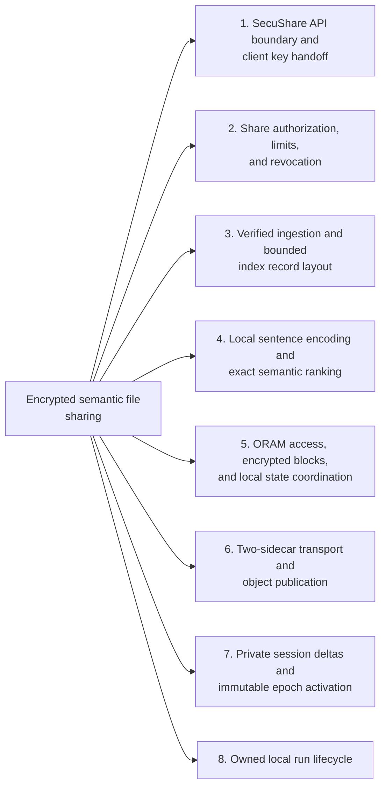

1. [SecuShare API boundary and client key handoff](#subsystem-secushare-api-boundary-and-client-key-handoff)
2. [Share authorization, limits, and revocation](#subsystem-share-authorization-limits-and-revocation)
3. [Verified ingestion and bounded index record layout](#subsystem-verified-ingestion-and-bounded-index-record-layout)
4. [Local sentence encoding and exact semantic ranking](#subsystem-local-sentence-encoding-and-exact-semantic-ranking)
5. [ORAM access, encrypted blocks, and local state coordination](#subsystem-oram-access-encrypted-blocks-and-local-state-coordination)
6. [Two-sidecar transport and object publication](#subsystem-two-sidecar-transport-and-object-publication)
7. [Private session deltas and immutable epoch activation](#subsystem-private-session-deltas-and-immutable-epoch-activation)
8. [Owned local run lifecycle](#subsystem-owned-local-run-lifecycle)

The inherited SecuShare app provides authenticated upload, share, download and revocation. The added Python research client calls those APIs, verifies share decryption, embeds text locally and stores fixed-size encrypted index blocks through two loopback sidecars. A [trusted client](#trusted-client) coordinates both sidecars. Their [XOR-split bytes](#sidecar-share) are a storage demonstration, not formal secure multiparty computation (MPC), a non-collusion guarantee or a proof against either sidecar.

</details>

<details>
<summary>Expand flow diagram 1</summary>

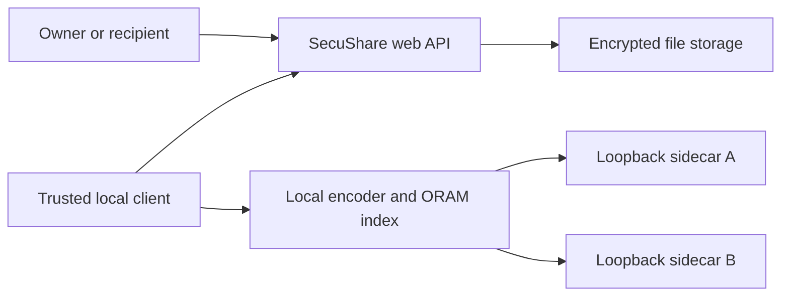

</details>

Caption: the existing app manages file sharing; the local research client adds semantic indexing and sends randomized storage shares to two loopback processes.

<details>
<summary>Expand flow diagram 2</summary>

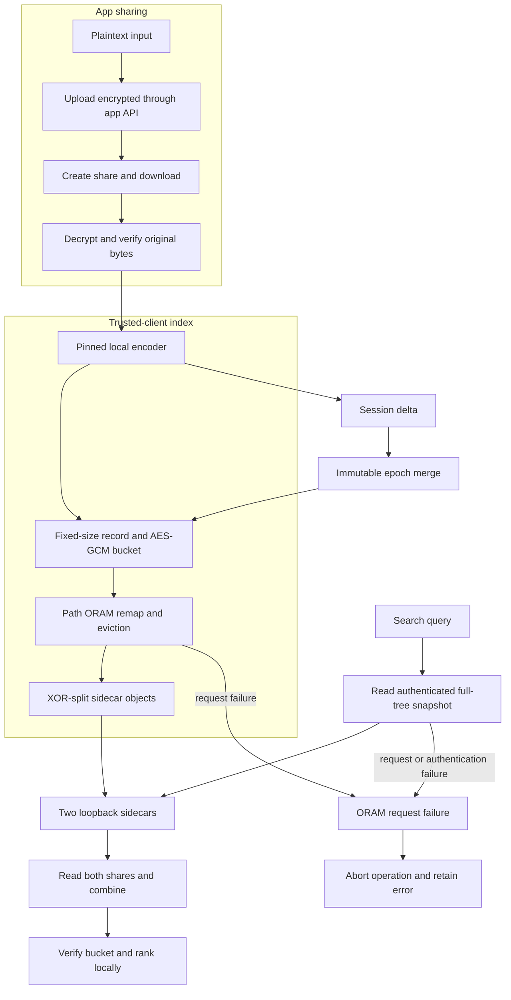

</details>

The client indexes only bytes that it has decrypted and checked. During search the trusted client combines sidecar replies, decrypts buckets and ranks vectors locally. Epoch merging writes that session's changes into a new immutable base epoch and updates only that session's local epoch pointer.

| Subsystem | Responsibility and owned state | Source |
| --- | --- | --- |
| App API adapter | Restricts the API base to loopback and performs encrypted upload/share/download operations. | [`app_client.py`](research/semantic-sharing/src/semshare/app_client.py) |
| Ingest workflow | Checks plaintext limits, verifies round-trip bytes, tests tamper rejection and packs the index record. | [`workflow.py`](research/semantic-sharing/src/semshare/workflow.py) |
| Sentence encoder | Loads the pinned model and produces local vectors. | [`encoder.py`](research/semantic-sharing/src/semshare/encoder.py) |
| Path ORAM client | Owns encrypted buckets, position map, stash, remapping and workspace revision. | [`oram.py`](research/semantic-sharing/src/semshare/oram.py) |
| Sidecar pair and object store | Store each randomized share separately and serve bounded loopback object requests. | [`oram.py`](research/semantic-sharing/src/semshare/oram.py), [`sidecar.py`](research/semantic-sharing/src/semshare/sidecar.py) |
| Workspace and sessions | Isolate corpus state, session deltas and immutable merged epochs. | [`workspace.py`](research/semantic-sharing/src/semshare/workspace.py), [`lifecycle.py`](research/semantic-sharing/src/semshare/lifecycle.py) |

Execution journey:

1. The owner uploads a bounded UTF-8 document through the existing app and creates a share.
2. The [trusted client](#trusted-client) downloads the share, decrypts it and checks that the bytes match the input. Tampered ciphertext must fail [authenticated encryption](#authenticated-encryption).
3. The pinned encoder creates an [embedding](#embedding). The client packs file and share references, key material, vector and content hashes into one bounded index record.
4. ORAM encrypts each bucket and writes an XOR mask and complementary bytes to the two loopback sidecars. If the second write fails, it attempts to delete the first sidecar's object.
5. A recipient imports an explicit share link into a separate corpus. Searches read and decrypt the needed index representation locally, then compute ranking on the trusted client.
6. A session delta can be merged into an immutable epoch. App revocation blocks later downloads but cannot revoke a key or plaintext already copied by a recipient.

| Choice in the current implementation | Practical rationale | Alternative and cost to reconsider |
| --- | --- | --- |
| Keep the app's existing sharing API as the file authority. | Exercises real authentication, ciphertext and revocation paths without replacing SecuShare. | A separate file service would no longer validate app integration. |
| Encode and rank on the trusted client. | Plaintext, keys and vectors remain available to the client that needs them. | Server-side ranking exposes more data or requires a different cryptographic protocol. |
| Use fixed-size encrypted buckets and a bounded Path ORAM index. | Hides record contents and uses explicit capacity limits in this research prototype. | A different index may reduce scans but changes its access-pattern and state model. |
| Split bucket bytes with XOR across two sidecars. | Demonstrates separated object storage with a small local client implementation. | This is not MPC: both shares together reconstruct the bucket, and the design provides no formal non-collusion guarantee. |
| Bind sidecars to loopback and local run state. | Keeps this demonstration within owned local processes and avoids exposing its simple object service. | Remote deployment requires transport authentication, threat analysis and a reviewed protocol. |

These rationales are inferred from the current code. The design is a local research prototype, not a production security architecture.

<a id="trusted-client"></a>

<details><summary>What is a trusted client?</summary>

A trusted client is the machine allowed to see plaintext and keys while performing operations for the user. Here, the Python process decrypts app shares, embeds text and ranks search results. The sidecars do not perform those steps.
</details>

<a id="path-oram"></a>

<details><summary>What is Path ORAM?</summary>

Path ORAM stores encrypted blocks in a tree and remaps a block to a random leaf when accessed. This code bounds an index to 1024 records and keeps a local position map and stash; the snapshot scan reads buckets in numeric order and does not hide that full-tree trace.
</details>

<a id="sidecar-share"></a>

<details><summary>What is an XOR sidecar share?</summary>

An XOR sidecar share is one of two byte strings whose bitwise XOR reconstructs a bucket. `SidecarPair` stores a random mask on one service and bucket XOR mask on the other. This storage split is not MPC and does not establish security if the parties collude.
</details>

<a id="authenticated-encryption"></a>

<details><summary>What is authenticated encryption?</summary>

Authenticated encryption protects data and detects changes made without the key. The app client uses AES-GCM for shared files; a tampered ciphertext is rejected rather than returned as valid plaintext.
</details>

<a id="embedding"></a>

<details><summary>What is an embedding?</summary>

An embedding is a numeric vector representing text for similarity comparisons. This client creates it locally with the pinned MiniLM encoder and stores its packed float32 values in the encrypted index record.
</details>

<a id="session-delta"></a>

<details><summary>What is a session delta?</summary>

A session delta is a private set of index changes made in one recipient session before they are merged. The client keeps session namespaces separate so one recipient's local corpus changes do not automatically enter another's search state.
</details>

<a id="revocation-limit"></a>

<details><summary>What is the revocation limit?</summary>

Revocation prevents future downloads through the app's share API. It cannot erase plaintext or a key already copied by a recipient, so this client keeps the secret in its local state and explicit share link.
</details>

## Implementation techniques

This section covers the active research client, the SecuShare share API paths it calls, and the local run lifecycle. Other application endpoints and frontend screens are outside this execution path. The reasons below are inferred from current code, not historical design records. The two sidecars do not implement MPC, assume non-collusion, or provide formal security.

<details>
<summary>Full technique index</summary>

| Subsystem | Technique cards | Source |
| --- | --- | --- |
| SecuShare API and client key handoff | [Loopback API and CSRF boundary](#technique-api-origin-csrf-boundary), [Client-side authenticated encryption](#technique-client-encryption), [Authenticated share round trip](#technique-verified-share-roundtrip) | [`app_client.py`](research/semantic-sharing/src/semshare/app_client.py), [`workflow.py`](research/semantic-sharing/src/semshare/workflow.py), [`cli.py`](research/semantic-sharing/src/semshare/cli.py) |
| Share access and revocation | [Server-enforced share availability gates](#technique-share-availability-gates) | [`share_handler.go`](backend/internal/handler/share_handler.go), [`share_service.go`](backend/internal/service/share_service.go), [`share_repository.go`](backend/internal/repository/share_repository.go), [`app_client.py`](research/semantic-sharing/src/semshare/app_client.py) |
| Ingest and record layout | [Authenticated share round trip](#technique-verified-share-roundtrip), [Fixed-size index record packing](#technique-bounded-index-record) | [`workflow.py`](research/semantic-sharing/src/semshare/workflow.py), [`app_client.py`](research/semantic-sharing/src/semshare/app_client.py) |
| Local embeddings and ranking | [Masked mean pooling](#technique-model-mean-pooling), [Cosine top-k with an oracle](#technique-embedding-ranking), [Authenticated full-tree snapshots](#technique-full-tree-snapshot) | [`encoder.py`](research/semantic-sharing/src/semshare/encoder.py), [`workspace.py`](research/semantic-sharing/src/semshare/workspace.py), [`oram.py`](research/semantic-sharing/src/semshare/oram.py) |
| ORAM state and concurrency | [Path ORAM access](#technique-path-oram-access), [Padded authenticated bucket slots](#technique-fixed-slot-aead), [Authenticated manifest replacement](#technique-authenticated-manifest), [Bounded client state locking](#technique-client-state-lock) | [`oram.py`](research/semantic-sharing/src/semshare/oram.py) |
| Sidecar storage and transport | [Random XOR share splitting](#technique-xor-share-splitting), [Pooled bounded HTTP transport](#technique-bounded-sidecar-transport), [Atomic sidecar object writes](#technique-atomic-sidecar-object-write) | [`oram.py`](research/semantic-sharing/src/semshare/oram.py), [`sidecar.py`](research/semantic-sharing/src/semshare/sidecar.py) |
| Session deltas and epoch merge | [Session-private deltas](#technique-session-epoch-merge), [Immutable epoch publication](#technique-immutable-snapshots) | [`workspace.py`](research/semantic-sharing/src/semshare/workspace.py) |
| Local verification run lifecycle | [Owned-process launch and cleanup](#technique-owned-run-lifecycle) | [`lifecycle.py`](research/semantic-sharing/src/semshare/lifecycle.py) |

</details>

<a id="subsystem-secushare-api-boundary-and-client-key-handoff"></a>

### 1. SecuShare API boundary and client key handoff

[Back to the subsystem map](#architecture-and-execution-guide).

**Code.** [`research/semantic-sharing/src/semshare/app_client.py`](research/semantic-sharing/src/semshare/app_client.py), [`research/semantic-sharing/src/semshare/cli.py`](research/semantic-sharing/src/semshare/cli.py).

**Techniques.** [Loopback API and CSRF request boundary](#technique-api-origin-csrf-boundary), [Client-side AES-GCM and fragment key handoff](#technique-client-encryption), [Authenticated share round-trip verification](#technique-verified-share-roundtrip).

**Related concepts.** [trusted client](#trusted-client), [authenticated encryption](#authenticated-encryption), [embedding](#embedding).

<a id="technique-api-origin-csrf-boundary"></a>

<details>
<summary>Loopback API and CSRF request boundary</summary>

**Mechanism.** `SecuShareClient` accepts only the local IPv4 API URL at `/api/v1`, rejects path traversal, and pins the origin for later requests. It attaches the guest bearer token and, on state-changing requests, validates the CSRF token before sending it in both the header and cookie. Its redirect handler refuses a different origin.

**Example.** A `POST /shares/` carries the current bearer token and matching `X-CSRF-Token` and `csrf_token` cookie.

**Why here.** The research client exercises the existing app API while keeping credentials and cookies within its local app boundary.

**Tradeoffs.** The adapter supports only local HTTP. It does not provide a remote deployment transport or TLS policy.

**Code and ownership.** [`app_client.py`](research/semantic-sharing/src/semshare/app_client.py#L23) `_validate_api_base`, [`app_client.py`](research/semantic-sharing/src/semshare/app_client.py#L43) `redirect_request`, and [`app_client.py`](research/semantic-sharing/src/semshare/app_client.py#L68) `request`. Extension.


**Used in.** [SecuShare API boundary and client key handoff](#subsystem-secushare-api-boundary-and-client-key-handoff). [Back to the subsystem map](#architecture-and-execution-guide).

</details>

<a id="technique-client-encryption"></a>

<details>
<summary>Client-side authenticated encryption</summary>

**Mechanism.** The client generates a content key and nonce, encrypts bytes with AES-GCM before upload, and keeps key material in the sharing link fragment. Download retrieves ciphertext and decrypts locally; GCM rejects modified ciphertext.

**Example.** `AESGCM(key).encrypt(nonce, plaintext, None)` produces the upload body.

**Why here.** The service stores ciphertext while the trusted client handles plaintext and key material.

**Tradeoffs.** The service cannot search plaintext content. Anyone holding the link fragment can access its key; the trusted client remains in the security boundary.

**Code and ownership.** [`research/semantic-sharing/src/semshare/app_client.py`](research/semantic-sharing/src/semshare/app_client.py#L104) `upload_encrypted`. Extension using cryptography.


**Used in.** [SecuShare API boundary and client key handoff](#subsystem-secushare-api-boundary-and-client-key-handoff). [Back to the subsystem map](#architecture-and-execution-guide).

</details>

<a id="technique-verified-share-roundtrip"></a>

<details>
<summary>Authenticated share round-trip verification</summary>

**Mechanism.** The workflow encrypts and uploads the source bytes, creates a real app share, downloads its ciphertext, checks the response checksum and nonce, then decrypts with AES-GCM. It compares recovered bytes with the original before embedding. It also flips one ciphertext bit and one nonce bit and requires both decryptions to fail authentication.

**Example.** `if decrypted != plaintext: raise RuntimeError(...)` prevents an unverified download from entering the index.

**Why here.** The semantic index should refer to the bytes recovered through the same app share path a recipient uses.

**Tradeoffs.** Ingest adds a share download and local verification work. The workflow proves the exercised documents and path, not every app configuration.

**Code and ownership.** [`workflow.py`](research/semantic-sharing/src/semshare/workflow.py#L27) `upload_share_and_embed`, [`app_client.py`](research/semantic-sharing/src/semshare/app_client.py#L139) `download_share`, and [`app_client.py`](research/semantic-sharing/src/semshare/app_client.py#L196) `verify_tamper_rejection`. Extension.


**Used in.** [SecuShare API boundary and client key handoff](#subsystem-secushare-api-boundary-and-client-key-handoff), [Verified ingestion and bounded index record layout](#subsystem-verified-ingestion-and-bounded-index-record-layout). [Back to the subsystem map](#architecture-and-execution-guide).

</details>

<a id="subsystem-share-authorization-limits-and-revocation"></a>

### 2. Share authorization, limits, and revocation

[Back to the subsystem map](#architecture-and-execution-guide).

**Code.** [`backend/internal/handler/share_handler.go`](backend/internal/handler/share_handler.go), [`backend/internal/service/share_service.go`](backend/internal/service/share_service.go), [`backend/internal/repository/share_repository.go`](backend/internal/repository/share_repository.go), [`research/semantic-sharing/src/semshare/app_client.py`](research/semantic-sharing/src/semshare/app_client.py), [`research/semantic-sharing/src/semshare/cli.py`](research/semantic-sharing/src/semshare/cli.py).

**Techniques.** [Server-enforced share expiry, download limits, and revocation](#technique-share-availability-gates).

<a id="technique-share-availability-gates"></a>

<details>
<summary>Server-enforced share expiry, download limits, and revocation</summary>

**Mechanism.** The inherited share service rejects inactive, expired, or exhausted shares. Before returning a file, it atomically increments the download count only while the share remains active, unexpired, and below its limit. The owner can deactivate a share; later requests fail. The research client checks the post-revocation response.

**Example.** `IncrementDownloadCountAtomic` updates the count with SQL predicates for activity, expiry, and remaining downloads.

**Why here.** This preserves SecuShare as the authority for whether a future API download is allowed.

**Tradeoffs.** Revocation cannot erase a key or plaintext already copied by a recipient. The index does not revoke local records or cached content.

**Code and ownership.** [`share_service.go`](backend/internal/service/share_service.go#L270) `GetFile`, [`share_repository.go`](backend/internal/repository/share_repository.go#L105) `IncrementDownloadCountAtomic`, [`share_handler.go`](backend/internal/handler/share_handler.go#L324) `DownloadFile`, and [`app_client.py`](research/semantic-sharing/src/semshare/app_client.py#L222) `deactivate_share`. Inherited app behavior and extension-side check.


**Used in.** [Share authorization, limits, and revocation](#subsystem-share-authorization-limits-and-revocation). [Back to the subsystem map](#architecture-and-execution-guide).

</details>

<a id="subsystem-verified-ingestion-and-bounded-index-record-layout"></a>

### 3. Verified ingestion and bounded index record layout

[Back to the subsystem map](#architecture-and-execution-guide).

**Code.** [`research/semantic-sharing/src/semshare/workflow.py`](research/semantic-sharing/src/semshare/workflow.py).

**Techniques.** [Fixed-size index record packing](#technique-bounded-index-record).

**Shared techniques.** [Authenticated share round-trip verification](#technique-verified-share-roundtrip).

<a id="technique-bounded-index-record"></a>

<details>
<summary>Fixed-size index record packing</summary>

**Mechanism.** The workflow packs the 384 float values as little-endian float32, base64-encodes that vector and key fields into compact JSON, and checks that the complete record fits one 4 KiB ORAM block. It stores plaintext and ciphertext hashes with the file and share references.

**Example.** `struct.pack(f"<{DIMENSION}f", *vector)` fixes the vector byte layout before the JSON record is measured.

**Why here.** One bounded record lets the ORAM client keep each document reference and vector in one encrypted block.

**Tradeoffs.** The fixed dimension and one-block limit reject larger records. Base64 and JSON add bytes over a binary record format.

**Code and ownership.** [`workflow.py`](research/semantic-sharing/src/semshare/workflow.py#L56) `create_index_record`. Extension.


**Used in.** [Verified ingestion and bounded index record layout](#subsystem-verified-ingestion-and-bounded-index-record-layout). [Back to the subsystem map](#architecture-and-execution-guide).

</details>

<a id="subsystem-local-sentence-encoding-and-exact-semantic-ranking"></a>

### 4. Local sentence encoding and exact semantic ranking

[Back to the subsystem map](#architecture-and-execution-guide).

**Code.** [`research/semantic-sharing/src/semshare/encoder.py`](research/semantic-sharing/src/semshare/encoder.py), [`research/semantic-sharing/src/semshare/workspace.py`](research/semantic-sharing/src/semshare/workspace.py).

**Techniques.** [Masked mean pooling and vector normalization](#technique-model-mean-pooling), [Exact cosine top-k with a fresh oracle](#technique-embedding-ranking), [Authenticated full-tree read-only snapshots](#technique-full-tree-snapshot).

**Related concepts.** [trusted client](#trusted-client), [embedding](#embedding).

<a id="technique-model-mean-pooling"></a>

<details>
<summary>Masked mean pooling and vector normalization</summary>

**Mechanism.** The local encoder tokenizes batches with padding and truncates them at 256 tokens. It multiplies the final hidden states by the attention mask, averages only unmasked token positions, then L2-normalizes each 384-value vector. Inference runs on CPU in inference mode with a locally verified pinned model.

**Example.** `(hidden * mask).sum(dim=1) / mask.sum(dim=1).clamp(min=1)` excludes padding from the pooled sentence vector.

**Why here.** The client needs a repeatable local vector for each verified document and query.

**Tradeoffs.** Text after the token limit does not affect the vector. The model dependency determines the learned representation and remains part of the trusted client.

**Code and ownership.** [`encoder.py`](research/semantic-sharing/src/semshare/encoder.py#L16) `SentenceEncoder` and [`encoder.py`](research/semantic-sharing/src/semshare/encoder.py#L32) `encode`. Mixed: extension and pinned model dependency.


**Used in.** [Local sentence encoding and exact semantic ranking](#subsystem-local-sentence-encoding-and-exact-semantic-ranking). [Back to the subsystem map](#architecture-and-execution-guide).

</details>

<a id="technique-embedding-ranking"></a>

<details>
<summary>Embedding ranking with a fresh cosine oracle</summary>

**Mechanism.** The pinned sentence encoder creates normalized mean-pooled vectors. Search scores candidates by cosine similarity; the independent `cosine` helper recalculates using float64 for a separate numerical check.

For encoder-produced normalized queries, the search dot product must match the oracle within `1e-6`. Ties sort by the stable file/share reference before the result limit is applied.

**Example.** A query embedding is scored against stored document vectors and sorted by descending score.

**Why here.** The semantic workspace needs ranked retrieval while retaining an independent check of the optimized scoring path.

**Tradeoffs.** Ranking depends on the pinned model and corpus. The oracle verifies cosine calculations, not semantic relevance.

**Code and ownership.** [`research/semantic-sharing/src/semshare/encoder.py`](research/semantic-sharing/src/semshare/encoder.py#L32) `encode` and line 56 `cosine`. Mixed: extension and model dependency.


**Used in.** [Local sentence encoding and exact semantic ranking](#subsystem-local-sentence-encoding-and-exact-semantic-ranking). [Back to the subsystem map](#architecture-and-execution-guide).

</details>

<a id="technique-full-tree-snapshot"></a>

<details>
<summary>Authenticated full-tree read-only snapshots</summary>

**Mechanism.** `records()` calls `_snapshot`, which visits every bucket object in numeric tree order, decrypts every slot, checks block placement and duplicate IDs, then checks that the union of remote blocks and stash matches the position map. It returns records without changing the manifest revision or writing buckets.

**Example.** `Workspace.search` gets candidates from `base.records()` and `delta.records()` before it scores the query.

**Why here.** A full snapshot gives the exact search path every candidate while keeping the read operation non-mutating.

**Tradeoffs.** Each query reads the full tree, including empty buckets. Sidecars observe the full-tree request trace, and this does not hide the query from the trusted client.

**Code and ownership.** [`oram.py`](research/semantic-sharing/src/semshare/oram.py#L354) `records`, [`oram.py`](research/semantic-sharing/src/semshare/oram.py#L363) `_snapshot`, and [`workspace.py`](research/semantic-sharing/src/semshare/workspace.py#L84) `search`. Extension.


**Used in.** [Local sentence encoding and exact semantic ranking](#subsystem-local-sentence-encoding-and-exact-semantic-ranking). [Back to the subsystem map](#architecture-and-execution-guide).

</details>

<a id="subsystem-oram-access-encrypted-blocks-and-local-state-coordination"></a>

### 5. ORAM access, encrypted blocks, and local state coordination

[Back to the subsystem map](#architecture-and-execution-guide).

**Code.** [`research/semantic-sharing/src/semshare/oram.py`](research/semantic-sharing/src/semshare/oram.py).

**Techniques.** [Path ORAM remapping and bottom-up eviction](#technique-path-oram-access), [Padded fixed-slot authenticated buckets](#technique-fixed-slot-aead), [Authenticated manifest validation and atomic replacement](#technique-authenticated-manifest), [Bounded process and file locking](#technique-client-state-lock).

**Related concepts.** [trusted client](#trusted-client), [Path ORAM](#path-oram).

<a id="technique-path-oram-access"></a>

<details>
<summary>Path ORAM bucket access</summary>

**Mechanism.** The client maps each logical block to a random leaf, reads the root-to-leaf bucket path, decrypts and merges blocks into a stash, then assigns accessed blocks fresh leaves and writes the path back. Randomized shares split bucket objects across sidecars.

**Example.** A lookup reads one full path even when the requested logical block is only one item.

**Why here.** Fixed path access reduces direct visibility of the requested logical block to the sidecar.

**Tradeoffs.** Path reads and writes move more bytes than a direct lookup. The client and its coordinator are trusted; this is not MPC.

**Code and ownership.** [`research/semantic-sharing/src/semshare/oram.py`](research/semantic-sharing/src/semshare/oram.py#L1) `PathORAM`. Extension using cryptographic primitives.


**Used in.** [ORAM access, encrypted blocks, and local state coordination](#subsystem-oram-access-encrypted-blocks-and-local-state-coordination). [Back to the subsystem map](#architecture-and-execution-guide).

</details>

<a id="technique-fixed-slot-aead"></a>

<details>
<summary>Padded fixed-slot authenticated buckets</summary>

**Mechanism.** Each logical record stores a block ID, a four-byte length and up to 4 KiB of payload inside an AES-GCM slot with a fresh nonce and fixed associated data. The client pads the payload and fills every bucket's four slots with encrypted dummy records. Decryption checks the tag, slot size, encoded length and zero padding.

**Example.** A short payload and a full payload both occupy one `SLOT_BYTES` slot; the unused payload bytes are zero before encryption.

**Why here.** Fixed slot lengths hide per-bucket occupancy from a sidecar that sees only stored bytes.

**Tradeoffs.** Padding consumes storage and transfer bytes. It does not hide tree capacity or which object IDs the client requests.

**Code and ownership.** [`oram.py`](research/semantic-sharing/src/semshare/oram.py#L453) `_encrypt_block`, [`oram.py`](research/semantic-sharing/src/semshare/oram.py#L460) `_dummy_slot`, and [`oram.py`](research/semantic-sharing/src/semshare/oram.py#L463) `_decrypt_block`. Mixed: extension and AES-GCM dependency.


**Used in.** [ORAM access, encrypted blocks, and local state coordination](#subsystem-oram-access-encrypted-blocks-and-local-state-coordination). [Back to the subsystem map](#architecture-and-execution-guide).

</details>

<a id="technique-authenticated-manifest"></a>

<details>
<summary>Authenticated manifest validation and atomic replacement</summary>

**Mechanism.** The client serializes the position map, object IDs, stash, references and revision, encrypts the manifest with AES-GCM and fixed associated data, writes a pending file, flushes and `fsync`s it, then replaces the active manifest with `os.replace`. Loading authenticates before JSON parsing and validates schema, capacities, IDs, references and stash bounds.

**Example.** The active path is replaced only after the complete encrypted pending file has been flushed.

**Why here.** ORAM operations need recoverable client state that matches the committed encrypted buckets.

**Tradeoffs.** The local manifest and key remain on the trusted client. File replacement does not make the remote sidecar pair and local manifest one distributed transaction.

**Code and ownership.** [`oram.py`](research/semantic-sharing/src/semshare/oram.py#L482) `_save_state` and [`oram.py`](research/semantic-sharing/src/semshare/oram.py#L496) `_load_state`. Mixed: extension and AES-GCM dependency.


**Used in.** [ORAM access, encrypted blocks, and local state coordination](#subsystem-oram-access-encrypted-blocks-and-local-state-coordination). [Back to the subsystem map](#architecture-and-execution-guide).

</details>

<a id="technique-client-state-lock"></a>

<details>
<summary>Bounded process and file locking</summary>

**Mechanism.** `FileLock` first acquires a process-local reentrant lock, then obtains an exclusive OS file lock. It retries a non-blocking lock attempt until a monotonic deadline and releases both locks when the operation ends.

**Example.** If the lock is still held after its timeout, the caller raises `ORAMError` and does not proceed with stale position-map or stash state.

**Why here.** Search and ORAM mutations share local manifests and client-owned position maps.

**Tradeoffs.** A busy operation aborts after the timeout rather than waiting indefinitely. The lock coordinates processes on the same host and filesystem; it is not a distributed lock service.

**Code and ownership.** [`oram.py`](research/semantic-sharing/src/semshare/oram.py#L166) `FileLock`, [`oram.py`](research/semantic-sharing/src/semshare/oram.py#L176) `__enter__`, and [`oram.py`](research/semantic-sharing/src/semshare/oram.py#L210) `__exit__`. Extension.


**Used in.** [ORAM access, encrypted blocks, and local state coordination](#subsystem-oram-access-encrypted-blocks-and-local-state-coordination). [Back to the subsystem map](#architecture-and-execution-guide).

</details>

<a id="subsystem-two-sidecar-transport-and-object-publication"></a>

### 6. Two-sidecar transport and object publication

[Back to the subsystem map](#architecture-and-execution-guide).

**Code.** [`research/semantic-sharing/src/semshare/oram.py`](research/semantic-sharing/src/semshare/oram.py), [`research/semantic-sharing/src/semshare/sidecar.py`](research/semantic-sharing/src/semshare/sidecar.py).

**Techniques.** [Random XOR share publication with compensation](#technique-xor-share-splitting), [Pooled HTTP with strict sidecar frame bounds](#technique-bounded-sidecar-transport), [Atomic no-overwrite sidecar object publication](#technique-atomic-sidecar-object-write).

**Related concepts.** [trusted client](#trusted-client).

<a id="technique-xor-share-splitting"></a>

<details>
<summary>Random XOR share splitting</summary>

**Mechanism.** `SidecarPair.put` creates a random byte mask, stores it on the first sidecar, and stores the XOR of the bucket and mask on the second. `get` fetches both shares and XORs them to reconstruct the bucket. If the second write fails, the client attempts to delete the first share.

**Example.** `mask XOR (bucket XOR mask)` reconstructs the bucket byte for byte.

**Why here.** Either sidecar alone lacks the plaintext bucket bytes when the mask is random.

**Tradeoffs.** Reads require both sidecars. A failed compensation can leave an incomplete pair, and this scheme does not hide access patterns from the trusted client.

**Code and ownership.** [`research/semantic-sharing/src/semshare/oram.py`](research/semantic-sharing/src/semshare/oram.py#L140) `SidecarPair.put` and `SidecarPair.get`. Extension.


**Used in.** [Two-sidecar transport and object publication](#subsystem-two-sidecar-transport-and-object-publication). [Back to the subsystem map](#architecture-and-execution-guide).

</details>

<a id="technique-bounded-sidecar-transport"></a>

<details>
<summary>Pooled HTTP with strict sidecar frame bounds</summary>

**Mechanism.** Each `Sidecar` reuses one HTTPX client with a two-second timeout, environment proxies disabled and redirects disabled. The client accepts only loopback URLs, rejects encoded responses, reads raw response chunks only up to one bucket plus one byte, and requires exact bucket lengths on `GET` and `PUT`. The server requires a decimal `Content-Length` within its object limit and rejects short bodies.

**Example.** A response of `BUCKET_BYTES + 1` is rejected instead of accumulated without a bound.

**Why here.** Persistent local requests avoid rebuilding a transport per bucket while keeping payload framing bounded.

**Tradeoffs.** The protocol requires fixed-size bucket payloads and ordinary content-length framing. It is a loopback object API without remote transport authentication.

**Code and ownership.** [`oram.py`](research/semantic-sharing/src/semshare/oram.py#L47) `Sidecar`, [`oram.py`](research/semantic-sharing/src/semshare/oram.py#L78) `request`, and [`sidecar.py`](research/semantic-sharing/src/semshare/sidecar.py#L85) `Handler.do_PUT`. Mixed: extension and HTTPX transport dependency.


**Used in.** [Two-sidecar transport and object publication](#subsystem-two-sidecar-transport-and-object-publication). [Back to the subsystem map](#architecture-and-execution-guide).

</details>

<a id="technique-atomic-sidecar-object-write"></a>

<details>
<summary>Atomic no-overwrite sidecar object publication</summary>

**Mechanism.** `ObjectStore.put` validates the object length and refuses an existing target. It writes to a temporary file in the same directory, flushes and `fsync`s the bytes, then hard-links the completed temporary file to the final random object name. The `finally` block removes the temporary name.

**Example.** Concurrent writers for one object ID cannot replace a previously published object; the link operation fails if the target already exists.

**Why here.** Readers should see either no object or the completed object, including when two requests race for the same ID.

**Tradeoffs.** The filesystem must support same-directory hard links. This protects one sidecar object write, not atomic publication across both sidecars.

**Code and ownership.** [`sidecar.py`](research/semantic-sharing/src/semshare/sidecar.py#L17) `ObjectStore` and [`sidecar.py`](research/semantic-sharing/src/semshare/sidecar.py#L27) `put`. Extension.


**Used in.** [Two-sidecar transport and object publication](#subsystem-two-sidecar-transport-and-object-publication). [Back to the subsystem map](#architecture-and-execution-guide).

</details>

<a id="subsystem-private-session-deltas-and-immutable-epoch-activation"></a>

### 7. Private session deltas and immutable epoch activation

[Back to the subsystem map](#architecture-and-execution-guide).

**Code.** [`research/semantic-sharing/src/semshare/workspace.py`](research/semantic-sharing/src/semshare/workspace.py).

**Techniques.** [Session-private deltas and isolated visibility](#technique-session-epoch-merge), [Immutable epoch publication with failure rollback](#technique-immutable-snapshots).

**Related concepts.** [session delta](#session-delta).

<a id="technique-session-epoch-merge"></a>

<details>
<summary>Session-scoped epoch merge</summary>

**Mechanism.** A session reads an immutable base snapshot at its epoch, stores its writes separately, and merges those writes when it commits. The merge updates only that session's immutable base epoch; it does not rewrite the shared global corpus.

**Example.** Two sessions with independent bases can retain distinct updates without silently overwriting the global index.

**Why here.** Session-local snapshots keep concurrent search state isolated.

**Tradeoffs.** Sessions keep independent base and delta state and do not automatically observe one another's additions or merges. Session IDs partition trusted-client state; they are not authentication identities or a security boundary. The project does not claim automatic global conflict resolution.

**Code and ownership.** [`research/semantic-sharing/src/semshare/workspace.py`](research/semantic-sharing/src/semshare/workspace.py) session epoch operations. Extension.


**Used in.** [Private session deltas and immutable epoch activation](#subsystem-private-session-deltas-and-immutable-epoch-activation). [Back to the subsystem map](#architecture-and-execution-guide).

</details>

<a id="technique-immutable-snapshots"></a>

<details>
<summary>Immutable ORAM snapshots</summary>

**Mechanism.** A merge writes the combined base and session delta into a fresh epoch directory, then changes that session's active epoch pointer. The prior epoch remains stored. Readers open the epoch selected by their session state.

**Example.** `Workspace.merge` assigns a new `e-...` directory to `active_epochs[session_id]` after `PathORAM.create` succeeds.

**Why here.** Building a complete epoch before pointer replacement avoids exposing a partially merged index.

**Tradeoffs.** Old epochs consume storage and cleanup is not part of this merge operation. A failed sidecar write can leave unreferenced remote objects, and remote garbage collection is not implemented. Epoch publication is local state, not a shared global corpus update.

**Code and ownership.** [`research/semantic-sharing/src/semshare/workspace.py`](research/semantic-sharing/src/semshare/workspace.py#L113) `Workspace.merge`. Extension.


**Used in.** [Private session deltas and immutable epoch activation](#subsystem-private-session-deltas-and-immutable-epoch-activation). [Back to the subsystem map](#architecture-and-execution-guide).

</details>

<a id="subsystem-owned-local-run-lifecycle"></a>

### 8. Owned local run lifecycle

[Back to the subsystem map](#architecture-and-execution-guide).

**Code.** [`research/semantic-sharing/src/semshare/lifecycle.py`](research/semantic-sharing/src/semshare/lifecycle.py).

**Techniques.** [Owned-process launch and identity-checked cleanup](#technique-owned-run-lifecycle).

<a id="technique-owned-run-lifecycle"></a>

<details>
<summary>Owned-process launch and identity-checked cleanup</summary>

**Mechanism.** `start` refuses reused run and evidence directories, writes run-specific state, launches the app and two sidecars with isolated storage and caches, then waits for health checks. A launch failure stops the children it started. `cleanup` verifies each remaining PID still matches the recorded executable or sidecar arguments, copies logs to retained evidence, and removes only the run directory.

**Example.** Before forced termination, `_is_owned` checks the process identity again so a reused PID is not killed as if it were the original child.

**Why here.** The verification workflow owns disposable services and data while preserving logs after cleanup.

**Tradeoffs.** Process identity inspection is platform-specific. This lifecycle controls only the recorded local run and does not sandbox the host.

**Code and ownership.** [`lifecycle.py`](research/semantic-sharing/src/semshare/lifecycle.py#L33) `start`, [`lifecycle.py`](research/semantic-sharing/src/semshare/lifecycle.py#L187) `cleanup`, and [`lifecycle.py`](research/semantic-sharing/src/semshare/lifecycle.py#L303) `_is_owned`. Extension.


**Used in.** [Owned local run lifecycle](#subsystem-owned-local-run-lifecycle). [Back to the subsystem map](#architecture-and-execution-guide).

</details>

## Guide

[Implementation techniques](#implementation-techniques) ·
[Architecture and execution guide](#architecture-and-execution-guide) · [Run and verify](#run-and-verify) · [Current index-only scan results](#current-index-only-scan-results) · [Trust and current scope](#trust-and-current-scope) · [Source and research](#source-and-research)

## Run and verify

See [research client setup and commands](research/semantic-sharing/README.md) and the [maintained verification skill](.agents/skills/verify-encrypted-semantic-sharing/SKILL.md). Native app verification needs Python 3.11, Go with CGO, and a C compiler. The driver launches only synthetic documents and loopback services, then preserves evidence while cleaning its own processes and scratch data.

```sh
python -m pip install -r research/semantic-sharing/requirements.txt
python -m pip install -e research/semantic-sharing --no-deps
python -m semshare download-model
python -m semshare launch
python -m semshare doctor --run-id <printed-run-id>
python -m semshare drive --run-id <printed-run-id>
python -m semshare cleanup --run-id <printed-run-id>
```

The deterministic storage and session tests run with `python -m unittest discover -s research/semantic-sharing/tests -v` after installation. The [native Ubuntu workflow](https://github.com/STEVVVU/encrypted-semantic-file-sharing/actions/runs/39721059173) passed frontend lint/tests/build, backend native race tests, 22 research tests, and the complete app/sidecar journey. [Retained synthetic evidence](docs/evidence/linux-39721059173/) records three encrypted uploads, recipient isolation, HTTP 403 private-file denial, HTTP 410 after revocation, cosine-ranking agreement, ORAM invariants and owned-process cleanup. The original workflow evidence uses `model.id` for the pinned revision hash; the model identity is the locked MiniLM model described above.

## Current index-only scan results

Two complete CPU-only campaigns compared the historical 64-record point-read search with the current snapshot scan. Both used the same pooled HTTPX transport and alternated the two methods over five rounds. At 64 records, the median of five round medians was 4.1747 s for point reads and 0.4004 s for snapshots in run A. Run B measured 4.7976 s and 0.4643 s. At 512 and 1,024 records, snapshot medians were 3.3072 s and 6.5588 s in A, and 3.7216 s and 7.4098 s in B. Each cell had 20 queries. The linked [campaign report and receipts](docs/evidence/scan-20261024/report.md) include ranges, request counts, bytes, source and model hashes, resource limits, and cleanup evidence.

This benchmark uses two loopback sidecars and does not start the SecuShare app or upload documents. A snapshot query reads 508 buckets at 64 records and 8,188 at 1,024 records, including the empty base tree. It receives 8,420,608 and 135,724,288 payload bytes per query at those sizes. Sidecars see the full-tree trace. The result does not establish general ORAM security, retrieval quality, WAN performance, production capacity, or a full-app upload result. The complete application integration still uses its separate 64-record workflow.

Run A's original summary has incorrect method labels. Its saved sample rows retain the actual labels, and the checker recomputes its summary without rewriting the receipt. Run B stores arm labels and all actual/oracle top-five pairs. Both complete runs passed all 80 queries with zero errors or rejections.

## Historical full-application metrics

The [hosted metrics run](https://github.com/STEVVVU/encrypted-semantic-file-sharing/actions/runs/39733590445) completed the [frozen corpus benchmark](.agents/skills/verify-encrypted-semantic-sharing/features/metrics.md) at source `e49209b`, using a four-vCPU Ubuntu runner, Python 3.11 and pinned CPU MiniLM revision `1110a243fdf4706b3f48f1d95db1a4f5529b4d41`. Four manually labeled paraphrase queries were repeated five times per cell, alternating encrypted/plaintext order. Every top-five reference and score matched exact float32-vector ranking. Search medians below are medians of the five per-repeat medians, with their range; query embedding is excluded.

This retained table is the historical point-read scan result from source `e49209b`. Its encrypted search performed one remapping ORAM read per record; it predates the current read-only full-tree snapshot and is not a measurement of the current search path.

| Records | Plain exact, delta / merged (ms) | Encrypted delta (s) | Encrypted merged (s) |
|---:|---:|---:|---:|
| 8 | 1.138 / 1.144 | 0.216 [0.212–0.217] | 0.212 [0.212–0.215] |
| 32 | 4.475 / 4.448 | 1.279 [1.270–1.302] | 1.287 [1.277–1.305] |
| 64 | 8.884 / 8.795 | 2.976 [2.955–3.016] | 3.001 [2.936–3.228] |

The plaintext path is an overhead floor that omits encryption, ORAM, network and durability. Warm query embedding took about 10 ms; at 64 records merged-search empirical p95 was 3.361 s across 20 queries. Four-query synthetic relevance had MRR/nDCG@5 1.0; precision@5 was 0.2/0.8/1.0 and recall@5 1.0/1.0/0.625 at 8/32/64 records. At 64 records there are eight same-topic documents, so top five can recover at most 5/8. These labels do not establish general document-search quality.

Scheduled rates 0.25/1/4 queries/s with worker limits 1/2/4 completed all 520 requests, with zero errors, rejections or timeouts. Median completed rates were **0.252/0.336/0.340 queries/s**. The overloaded 1/s and 4/s batches had per-run p95 ranges **61.4–65.5 s** and **102.0–105.4 s**, including queued time. Finite backlog completion is not sustainable 4/s capacity. A separate 61.4-second closed-loop stability check completed 21 correct searches. Per-cell p99 is omitted because there were fewer than 100 observations.

The separate historical point-read profile attributes the 64-record path to 64 serial ORAM reads/path commits and 2,688 sidecar requests under the trusted-client lock. Each query sent and received 14,852,096 payload bytes; headers/framing are excluded. Client peak RSS was 478,284 KiB. Before load testing, aggregate retained-index sidecar storage was 20,388,480 bytes across all three corpus workspaces and their retained epoch/delta trees, versus 7,744 unique uploaded plaintext bytes. This is not active-corpus storage amplification: superseded path buckets are deleted after durable commit, while whole old index generations remain.

[Curated cells, counts, hashes and limits](docs/evidence/metrics-39733590445/measurement.json) bind these results to the raw workflow artifact; cleanup stopped all three owned processes and removed scratch data. Reproduce with `python -m semshare.benchmark --run-id <fresh-id> --cache-dir <isolated-model-cache>` or the manual [metrics workflow](.github/workflows/metrics.yml). Ingest was one unreplicated 64-document pass at one document per 4.2 seconds, below the shipped file-request limiter; its success is not an upload-capacity measurement or a formal privacy result.

## Trust and current scope

This is a trusted-client research prototype. It implements a position map, stash, random leaf remapping, padded encrypted buckets and path eviction. Each index supports up to 1024 records, with a default workspace capacity of 64; a workspace can contain at most 64 session namespaces. Current `records()` snapshots read every bucket once in numeric tree order and do not remap records. Searches then rank the locally returned records; this is not a scalable private approximate-nearest-neighbor service. Session names separate views inside one trusted client, while separate workspace keys define separate client corpora.

The two sidecars are loopback processes on one machine. They do not establish independent non-colluding operators, MPC, malicious-client security or formal privacy. The app still stores filename, type and size metadata. Sidecars can distinguish full-tree scans from point reads and observe request timing, stable bucket object IDs, and tree capacity/object count. Fixed-size encrypted buckets hide per-bucket occupancy from sidecars; a local observer of the encrypted client manifest can infer coarse index and stash size from ciphertext length. See the [detailed trust boundary](research/semantic-sharing/README.md#trust-and-privacy-boundary).

The [index-only scan benchmark](research/semantic-sharing/README.md#index-only-scan-benchmark) compares the current path against the historical 64-record point-read implementation and measures snapshot scans at 512 and 1,024 records. It uses two loopback sidecars and does not start the Go/CGO app. See the [measured results and scope limits](docs/evidence/scan-20261024/report.md).

## Source and research

The full MIT-licensed SecuShare source and history are retained at upstream base `42590a03dbd1a8812ab4ad7b96e924969eea8bc0`. The original landing page is preserved as [README.upstream.md](README.upstream.md), and its original CI is retained under [archive/upstream-workflows](archive/upstream-workflows/). New code is under `research/semantic-sharing/`.

The coursework reference is Berkeley CS262a's [Constellation report](https://people.eecs.berkeley.edu/~kubitron/courses/cs262a-F25/projects/reports/project1006_paper_85262889807149618246.pdf). The ORAM adaptation follows [Path ORAM](https://pages.cs.wisc.edu/~yxy/pubs/PathORam.pdf). This project does not reproduce Constellation's distributed MPC protocol or either paper's scale and performance results.
